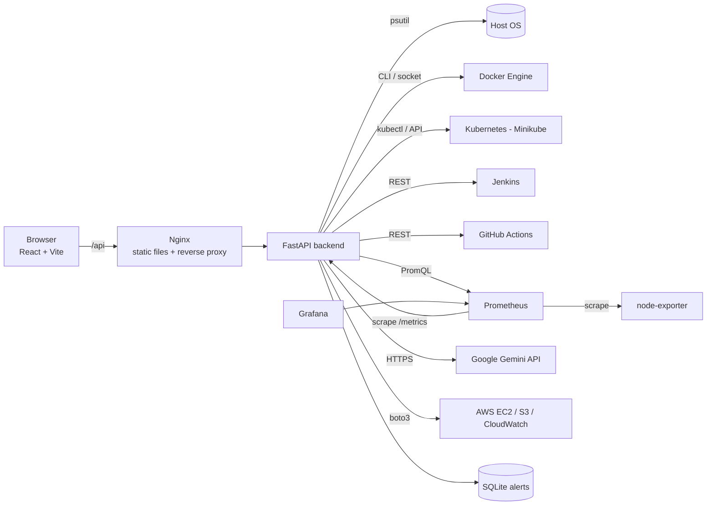

# DevOps AI Dashboard

A centralised, AI-powered DevOps dashboard. It monitors the machine it runs on,
Docker containers, Kubernetes (Minikube) workloads, Jenkins and GitHub Actions
pipelines, and Prometheus/Grafana. It raises alerts, and it uses Google Gemini to
explain errors and suggest fixes from real logs.

MCA project, built to run comfortably on an 8 GB RAM laptop.

| Module | What it does | Real tool behind it |
|---|---|---|
| 1. Overview | One screen: live host pulse, tool status, alerts, containers, pipelines | all of the below |
| 2. System monitoring | CPU, memory, disk, swap, network, disk I/O, top processes | psutil |
| 3. CI/CD monitoring | Jobs, builds, workflow runs, console logs, trigger/re-run | Jenkins REST API, GitHub Actions REST API |
| 4. Container monitoring | Containers + stats + logs + start/stop; pods, deployments, services, events | Docker CLI / Engine API, Kubernetes API (kubectl or in-cluster) |
| 5. Infrastructure monitoring | PromQL explorer, scrape targets, Prometheus alerts, Grafana dashboard, AWS EC2/S3/CloudWatch | Prometheus, node-exporter, Grafana, boto3 |
| 6. AI assistant | Chat grounded in live dashboard data; "Diagnose" any failure | Google Gemini API |
| 7. Log analysis | App, file, OS, container and pod logs; level detection; repeated-error grouping | log files, journalctl / Windows Event Log, docker logs, Kubernetes API |
| 8. Alerts & notifications | Threshold rules with "for N samples", tool failure detection, history, browser + Slack/Discord | SQLite, webhooks, Notification API |

## Architecture



The backend is the only component that talks to the tools. Each tool has one
**service** class (`backend/app/services/`) and one **router** (`backend/app/routers/`).
An integration that is not configured returns a clear message with a setup hint.
It never returns fake data.

## Quick start (development, Windows or Linux)

Requirements: Python 3.11+, Node.js 22 (or 20.19+).

```bash
# 1. Backend
cd backend
python -m venv venv
venv\Scripts\activate            # Windows   (Linux/macOS: source venv/bin/activate)
pip install -r requirements.txt
copy .env.example .env           # Linux/macOS: cp .env.example .env
uvicorn app.main:app --reload --port 8000
#   API docs: http://localhost:8000/docs

# 2. Frontend (second terminal)
cd frontend
npm install
npm run dev                      # http://localhost:5173
```

The System, Logs and Alerts modules work immediately. Everything else is
switched on **one phase at a time**. Follow **[docs/PHASES.md](docs/PHASES.md)**.

> The old `backend/venv` contained many unrelated packages (Jupyter, OpenCV,
> etc.). Delete it and create a fresh one as shown above. The new
> `requirements.txt` installs only 6 packages (about 25 MB).

## Run everything in Docker

```bash
docker compose up -d --build                         # dashboard on http://localhost:8080
docker compose --profile monitoring up -d --build    # + Prometheus :9090, Grafana :3000
docker compose --profile ci up -d --build jenkins    # + Jenkins :8081
```

## Tests

```bash
cd backend
pip install -r requirements-dev.txt
ruff check app tests
pytest -q
```

The suite has 20 tests: parsers, alert state machine, secret redaction, log
analysis, and API endpoints via FastAPI's TestClient, with Gemini mocked.
CI runs it in GitHub Actions (`.github/workflows/ci.yml`) and in Jenkins (`Jenkinsfile`).

## Repository layout

```
backend/            FastAPI app (app/), tests, Dockerfile, .env.example
frontend/           React app (src/), nginx.conf, Dockerfile
monitoring/         Prometheus config + alert rules, Grafana provisioning + dashboard
k8s/                Kubernetes manifests for Minikube (RBAC, ConfigMap, Deployments, Services)
jenkins/            Jenkins image with Docker CLI + plugin list
terraform/          AWS: EC2, IAM role, S3, SSM, CloudWatch alarms
.github/workflows/  GitHub Actions CI
Jenkinsfile         Jenkins pipeline
docs/               PHASES.md (step-by-step integration), VIVA_GUIDE.md (explanations)
```

## Approximate memory use

Estimates based on the memory limits set in `docker-compose.yml` and typical
footprints. Check the real numbers on your laptop with `docker stats` and the
System page.

| Running | RAM (approx.) |
|---|---|
| Backend + frontend (dev mode) | 150 MB |
| + Docker Compose app containers | 200 MB |
| + monitoring profile | +450 MB |
| + Jenkins | +700 MB |
| + Minikube (`--memory=2200`) | +2.2 GB |

Run only what the current phase needs and stop the rest (`docker compose stop`, `minikube stop`).
